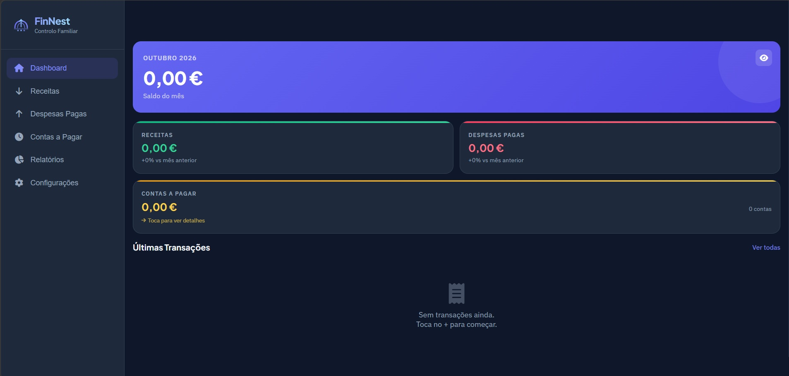

# FinNest — Controlo Financeiro

Aplicação de página única para gestão financeira pessoal e familiar, com registo de receitas e despesas, acompanhamento de saldos, gráficos e importação/exportação de dados.

## Experimentar

A aplicação está disponível em `https://srloga.github.io/finnest/` .

Para testar localmente, abre `index.html` num navegador.

## Tecnologias

HTML, CSS e JavaScript num único ficheiro; Chart.js, Font Awesome e Google Fonts carregados externamente.

## Dados e privacidade

Os dados são guardados no armazenamento local do navegador (localStorage).
Exportações JSON podem conter dados financeiros pessoais: não existe sincronização entre dispositivos nem cópia de segurança automática na nuvem.
Para preservar dados, usa a funcionalidade de exportação e guarda o ficheiro num local seguro.

## Publicação

Esta versão pública não inclui backups financeiros nem versões de teste.
